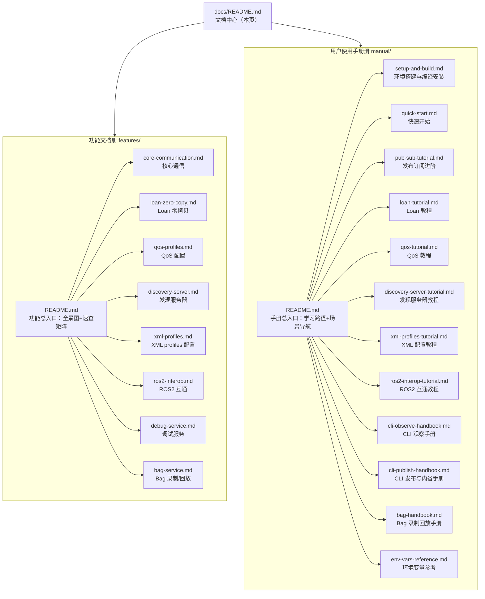

# YomkRpc 文档中心

本目录是 YomkRpc 的权威文档库，由两大册组成：

- **[功能文档册](./features/README.md)** — 说明 YomkRpc 提供哪些功能、能力边界与参数约束
- **[用户使用手册册](./manual/README.md)** — 手把手教程，照做即可完成安装、开发与调试

## 一、文档体系架构



## 二、读者画像与阅读路径

| 你是谁 / 你想做什么 | 推荐路径 |
|---|---|
| 第一次接触 YomkRpc，想把它跑起来 | [手册入口](./manual/README.md) → [环境搭建](./manual/setup-and-build.md) → [快速开始](./manual/quick-start.md) |
| 想知道 YomkRpc 有哪些能力、边界在哪 | [功能文档入口](./features/README.md) 的「功能速查矩阵」 |
| 已经会用，想查某个宏/命令/参数的细节 | 对应功能文档的「参数与约束」章节 |
| 想完成一个具体任务（录制 bag、跨域互通、对接 ROS2…） | [手册入口](./manual/README.md) 的「我想……」场景导航表 |
| 查环境变量与公共配置 | [环境变量与公共配置参考](./manual/env-vars-reference.md) |
| 想了解这套文档如何组织、如何参与维护 | 本页「设计原则」「写作规范」「维护规则」 |

## 三、设计原则

### 1. 双入口导航制

两大册各有一个**总入口页**（`features/README.md` 与 `manual/README.md`）。入口页只承担两件事：呈现全景（架构图 / 学习路径 / 速查矩阵）与提供导航链接。**正文细节一律不放进入口页**，保证入口轻量、稳定，内容演进只发生在小文档内部。

### 2. 小文档闭环原则

每个小文档职责单一且**内容闭环**：只读任意一篇，即可获得其职责范围内的全部信息，不被迫跳读其他文档。每篇文档的固定骨架保证闭环要素齐全：

- 功能文档册骨架：`功能定位 → 能力清单 → 使用方式概述 → 参数与约束 → 错误与边界行为 → 与其他功能的关系 → 教程链接`
- 用户手册册骨架：`目标 → 前提与准备 → 分步操作 → 预期输出 → 常见错误与排障 → 延伸阅读`

每篇开头用引用块「**本文档覆盖范围**」声明职责边界；确实需要前置知识时，在开头给出具体文档链接并说明要读到什么程度。

### 3. 内容来源唯一

所有宏名、命令、参数、环境变量、默认值与错误信息，以仓库根 `README.md` 与 `examples/` 已验证代码为唯一事实来源，文档不引入未经代码验证的描述。

## 四、写作规范

1. **语言**：中文。**文件名**：英文 kebab-case（利于 git 与工具链），文档内标题用中文。
2. **标题格式**：功能文档册一级标题为 `# 功能文档：<标题>`；用户手册册为 `# 使用手册：<标题>`。
3. **职责声明**：一级标题后紧跟 `> **本文档覆盖范围**：……` 引用块。
4. **代码示例**：C++ 示例必须是完整可编译程序（含头文件与 `main`），摘自 README 示例章节或 `examples/` 源码；命令示例给出可直接复制执行的 bash 行。
5. **链接约定**：同册使用 `./xxx.md`；跨册使用 `../features/xxx.md`、`../manual/xxx.md`；返回入口用 `./README.md`。
6. **图示**：入口页与全景图使用 Mermaid（GitHub 原生渲染），不引入外部图片。
7. 不使用表情符号。

## 五、与 README.md 的关系及维护规则

- `README.md` 定位为**项目门面**：项目简介、核心特性速览、三步快速开始、文档导航表。细节正文一律下沉到本目录。
- 本目录（docs/）是**权威文档源**；README 与 docs 冲突时以 docs 为准并回改 README。
- **新增/修改功能的维护流程**：
  1. 先更新对应的功能小文档（能力、参数、边界）与对应教程小文档（操作步骤）；
  2. 更新所在册入口页的速查矩阵/导航表；
  3. README 只需同步特性速览与导航表，不同步细节。
- 两个小文档存在交叉内容时（如发现服务器直配与 XML 打底的叠加关系），**指定一篇为主责方**，另一篇交叉链接过去，禁止两处重复维护同一段细节。

## 六、全部文档索引

```
docs/
├── README.md                          ← 本页（组织设计说明 + 总导航）
├── features/                          【功能文档册】
│   ├── README.md                      功能总入口（全景图 + 速查矩阵）
│   ├── core-communication.md          核心通信（节点/主题/发布订阅/回调）
│   ├── loan-zero-copy.md              Loan 借出零拷贝发布
│   ├── qos-profiles.md                QoS 配置
│   ├── discovery-server.md            发现服务器（UDP/TCP 直配、跨域互通）
│   ├── xml-profiles.md                XML profiles 配置（三级提取链）
│   ├── ros2-interop.md                ROS2 互通
│   ├── debug-service.md               调试服务（宏 + yomkrpc 观察类）
│   └── bag-service.md                 Bag 录制/回放/转换
└── manual/                            【用户使用手册册】
    ├── README.md                      手册总入口（学习路径 + 场景导航）
    ├── setup-and-build.md             环境搭建与编译安装
    ├── quick-start.md                 快速开始（第一个发布订阅）
    ├── pub-sub-tutorial.md            发布订阅进阶教程
    ├── loan-tutorial.md               Loan 零拷贝教程
    ├── qos-tutorial.md                QoS 配置教程
    ├── discovery-server-tutorial.md   发现服务器与跨域互通教程
    ├── xml-profiles-tutorial.md       XML profiles 配置教程
    ├── ros2-interop-tutorial.md       ROS2 互通教程
    ├── cli-observe-handbook.md        yomkrpc 观察手册
    ├── cli-publish-handbook.md        yomkrpc 发布与内省手册
    ├── bag-handbook.md                Bag 录制回放手册
    └── env-vars-reference.md          环境变量与公共配置参考
```
