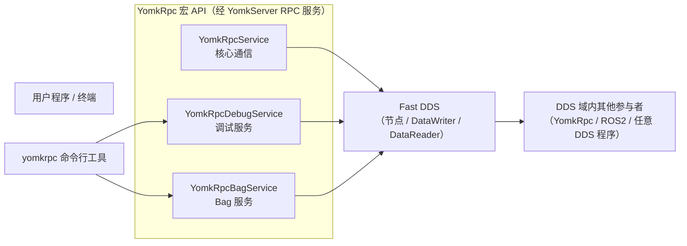

# 功能文档

本册回答一个问题：**YomkRpc 提供哪些功能，每个功能的能力边界与参数约束是什么**。

- 想知道「怎么一步步用」，请转到[用户使用手册册](../manual/README.md)
- 本册的阅读方式：从「功能全景」找到能力条目 → 进入对应小文档查「能力清单 / 参数与约束 / 错误与边界行为」

## 一、功能全景

YomkRpc 是 [YomkServer](https://github.com/Solitude-5309/YomkServer) 框架的 RPC 分布式通信扩展，集成 Fast DDS 提供分布式发布订阅能力。用户经 RPC 宏 API 操作三个服务域，另有 `yomkrpc` 命令行工具以 CLI 形式覆盖调试与 Bag 大部分能力：

三个服务域与 CLI 的职责划分：

| 服务域 | 职责 | 宏 API 前缀 | CLI 覆盖 |
|---|---|---|---|
| YomkRpcService | 节点生命周期、主题注册、发布订阅、Loan、XML 加载 | `YOMKRPC_*` | 不覆盖（编程能力） |
| YomkRpcDebugService | 类型无关的域内观察（主题/节点/类型/端点）与 JSON 载荷发布 | `YOMKRPC_DEBUG_*` | `yomkrpc topic/node/interface` 全部覆盖 |
| YomkRpcBagService | mcap 格式录制、元信息、重建索引、转换、回放 | `YOMKRPC_BAG_*` | `yomkrpc bag` 全部覆盖（play 仅 CLI） |

> 除 `YOMKRPC_VERSION()` 外，其余宏均返回 `YomkResponse`，调用后须判 `m_status == YomkResponse::eOk`；失败时可读 `m_msg` 获取错误信息。

## 二、功能速查矩阵

| 功能域 | 能力 | 宏 API | yomkrpc CLI | 详见 |
|---|---|---|---|---|
| 核心通信 | 版本查询 | `YOMKRPC_VERSION()` | — | [core-communication.md](./core-communication.md) |
| 核心通信 | 加载 XML profiles | `YOMKRPC_LOAD_XML(xmlPath)` | — | [xml-profiles.md](./xml-profiles.md) |
| 核心通信 | 创建/删除节点 | `YOMKRPC_NODE()` / `YOMKRPC_DEL_NODE()` | — | [core-communication.md](./core-communication.md) |
| 核心通信 | 注册发布/订阅主题 | `YOMKRPC_PUB_TOPIC()` / `YOMKRPC_SUB_TOPIC()` | — | [core-communication.md](./core-communication.md) |
| 核心通信 | 发布消息 | `YOMKRPC_PUB_MSG()` | — | [core-communication.md](./core-communication.md) |
| 核心通信 | Loan 借出零拷贝发布 | `YOMKRPC_LOAN()` / `YOMKRPC_DISCARD_LOAN()` | — | [loan-zero-copy.md](./loan-zero-copy.md) |
| QoS | 端点 QoS 描述（8 项 + ROS2 底座） | `DDSQosProfile`（qos 尾参） | `--qos-ros` / `--qos-*` / `--qos-file` | [qos-profiles.md](./qos-profiles.md) |
| 发现 | 发现服务器 UDP/TCP 直配 | `YOMKRPC_NODE/DEBUG_NODE/BAG_NODE` 定位串参数 | 发现服务器三环境变量 | [discovery-server.md](./discovery-server.md) |
| 发现 | XML profiles 三级提取链 | `YOMKRPC_LOAD_XML(xmlPath)` | — | [xml-profiles.md](./xml-profiles.md) |
| 互通 | 与 ROS2 收发同类型消息 | set_name 类型名直改（编程约定） | — | [ros2-interop.md](./ros2-interop.md) |
| 调试 | 主题消息观察 / 频率测量 | `YOMKRPC_DEBUG_TOPIC_PRINT()` | `topic print` / `topic hz` | [debug-service.md](./debug-service.md) |
| 调试 | 列出主题与节点 | `YOMKRPC_DEBUG_TOPIC_LIST(_T)` / `YOMKRPC_DEBUG_NODE_LIST()` | `topic list` / `node list` | [debug-service.md](./debug-service.md) |
| 调试 | 主题/节点详情（端点、GUID、QoS） | `YOMKRPC_DEBUG_TOPIC_INFO(_V)` / `YOMKRPC_DEBUG_NODE_INFO()` | `topic info` / `node info` | [debug-service.md](./debug-service.md) |
| 调试 | 按类型反查主题 | `YOMKRPC_DEBUG_TOPIC_FIND()` | `topic type` / `topic find` | [debug-service.md](./debug-service.md) |
| 调试 | 类型内省（IDL 结构） | `YOMKRPC_DEBUG_INTERFACE_SHOW/LIST()` | `interface show` / `interface list` | [debug-service.md](./debug-service.md) |
| 调试 | 发布示例与 JSON 载荷发布 | `YOMKRPC_DEBUG_TOPIC_EXAMPLE/MSG/PUB()` | `topic pub` | [debug-service.md](./debug-service.md) |
| Bag | 录制到 mcap（分片/缓存/暂停/通配） | `YOMKRPC_BAG_RECORD()` | `bag record` | [bag-service.md](./bag-service.md) |
| Bag | 查看 bag 元信息 | `YOMKRPC_BAG_INFO()` | `bag info` | [bag-service.md](./bag-service.md) |
| Bag | 重建 bag 元信息 | `YOMKRPC_BAG_REINDEX()` | `bag reindex` | [bag-service.md](./bag-service.md) |
| Bag | 转换 bag（过滤/裁剪/归并） | `YOMKRPC_BAG_CONVERT()` | `bag convert` | [bag-service.md](./bag-service.md) |
| Bag | 回放 bag | `YOMKRPC_BAG_PLAY()`（须先自建 bag 节点） | `bag play`（CLI 自动建删 bag 节点） | [bag-service.md](./bag-service.md) |

## 三、文档导航

| 文档 | 一句话职责 |
|---|---|
| [core-communication.md](./core-communication.md) | 节点生命周期、主题注册、发布订阅与回调消费、版本查询 |
| [loan-zero-copy.md](./loan-zero-copy.md) | plain 类型的借出（loan）零拷贝发布机制与池语义 |
| [qos-profiles.md](./qos-profiles.md) | DDSQosProfile 8 项配置、ROS2 预置底座、宏/CLI 两侧 QoS 优先级 |
| [discovery-server.md](./discovery-server.md) | 发现服务器 UDP/TCP 直配、CLIENT 协议、跨域互通 |
| [xml-profiles.md](./xml-profiles.md) | YOMKRPC_LOAD_XML 语义与 participant 三级 profile 提取链 |
| [ros2-interop.md](./ros2-interop.md) | set_name 类型名直改实现与 ROS2 互通约束 |
| [debug-service.md](./debug-service.md) | 调试服务与 yomkrpc 观察类命令的全能力说明 |
| [bag-service.md](./bag-service.md) | Bag 录制/元信息/重建/转换/回放全能力说明 |

> 横切主题：环境变量（域号、发现服务器开关、收敛次数等）统一记录在 [环境变量与公共配置参考](../manual/env-vars-reference.md)，功能文档不重复展开。
