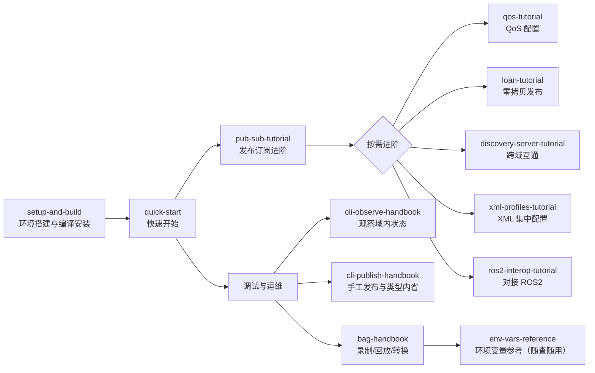

# 用户使用手册

本册是**面向操作**的手把手教程：每篇围绕一个目标，给出完整步骤、可直接复制执行的命令/代码、预期输出与排障方法，照做即可达成目标。

- 想先了解「YomkRpc 有哪些功能、边界在哪」，请转到[功能文档册](../features/README.md)
- 每篇教程开头声明覆盖范围与前提；遇到环境变量相关行为，统一查阅[环境变量与公共配置参考](./env-vars-reference.md)

## 一、学习路径

建议第一次使用按 `环境搭建 → 快速开始 → 发布订阅进阶` 顺序走完；之后按需进入分支。

## 二、按场景导航（我想……）

| 我想…… | 去这篇 |
|---|---|
| 安装依赖、编译并安装 YomkRpc | [setup-and-build.md](./setup-and-build.md) |
| 5 分钟跑通第一个发布订阅程序 | [quick-start.md](./quick-start.md) |
| 理解订阅回调、消息类型定义、多节点跨进程收发 | [pub-sub-tutorial.md](./pub-sub-tutorial.md) |
| 用零拷贝（loan）方式发布以提升性能 | [loan-tutorial.md](./loan-tutorial.md) |
| 控制可靠性、持久化、历史深度等传输语义 | [qos-tutorial.md](./qos-tutorial.md) |
| 在无多播/跨网段/跨域环境完成发现与互通 | [discovery-server-tutorial.md](./discovery-server-tutorial.md) |
| 用 XML 文件集中配置节点的 QoS/传输/发现 | [xml-profiles-tutorial.md](./xml-profiles-tutorial.md) |
| 让 YomkRpc 程序与 ROS2 节点互相收发 | [ros2-interop-tutorial.md](./ros2-interop-tutorial.md) |
| 看看域里现在有什么（主题/节点/频率观察） | [cli-observe-handbook.md](./cli-observe-handbook.md) |
| 不写代码就发一条消息、查看消息结构 | [cli-publish-handbook.md](./cli-publish-handbook.md) |
| 把数据录制下来，再回放/裁剪/合并 | [bag-handbook.md](./bag-handbook.md) |
| 查环境变量（域号、发现服务器、收敛次数等） | [env-vars-reference.md](./env-vars-reference.md) |

## 三、文档清单

| 文档 | 一句话简介 | 难度 |
|---|---|---|
| [setup-and-build.md](./setup-and-build.md) | 依赖检测、一键编译安装、验证安装 | 入门 |
| [quick-start.md](./quick-start.md) | 编译运行第一个发布订阅 + 双进程 hello world | 入门 |
| [pub-sub-tutorial.md](./pub-sub-tutorial.md) | 回调消费、消息类型、多节点多主题、资源清理 | 入门 |
| [loan-tutorial.md](./loan-tutorial.md) | plain 类型借出样本直接填值发布的完整流程 | 进阶 |
| [qos-tutorial.md](./qos-tutorial.md) | ROS2 底座选择、逐项覆盖、CLI QoS 参数 | 进阶 |
| [discovery-server-tutorial.md](./discovery-server-tutorial.md) | 发现服务器 UDP/TCP 直配与跨域互通实操 | 进阶 |
| [xml-profiles-tutorial.md](./xml-profiles-tutorial.md) | 编写 profiles XML、加载与验证 profile 命中 | 进阶 |
| [ros2-interop-tutorial.md](./ros2-interop-tutorial.md) | 与 ros2 CLI 双向收发实操 | 进阶 |
| [cli-observe-handbook.md](./cli-observe-handbook.md) | topic print/list/info/type/find/hz、node list/info | 工具 |
| [cli-publish-handbook.md](./cli-publish-handbook.md) | topic pub 全形态、interface show/list | 工具 |
| [bag-handbook.md](./bag-handbook.md) | bag record/info/play/convert/reindex 端到端 | 工具 |
| [env-vars-reference.md](./env-vars-reference.md) | 5 个环境变量的作用域、默认值与优先级 | 参考 |
